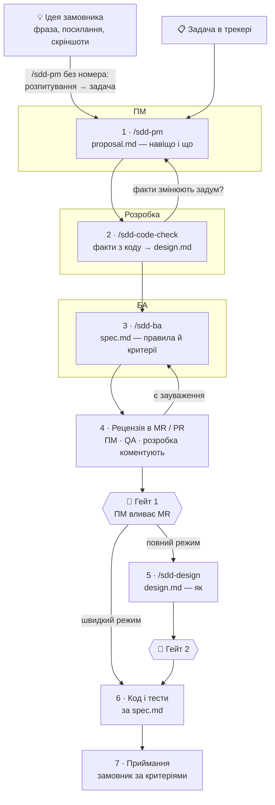

# SDD by role · специфікації фіч за ролями з Claude Code

*[English summary](README.en.md)*

Готовий каркас для команди, яка хоче домовлятися, **що** і **навіщо** робимо, перш ніж писати
код. Коли специфікація погоджена, розробка й тестування проходять за дні, а не за тижні
переписок.

Усю роботу з текстом веде [Claude Code](https://claude.com/claude-code): він ставить питання,
пише файли і сам працює з git і трекером (GitLab або GitHub). ПМ і БА не мусять знати git,
а ПМ — ще й код: факти про систему дає розробка окремим кроком.

**Що всередині:** конституція (правила гри), шаблони документів, чек-листи і п'ять скілів
Claude Code — по одному на роль і крок пайплайну.

## Пайплайн

**Хто що приносить:** замовник — ідею · ПМ — proposal (навіщо і що, по суті ТЗ) ·
БА — ролі й правила · розробка — факти з коду і «як». ПМ не мусить знати код: для цього є
крок 2, найкраще — спільна сесія ПМ і розробника.

Кожен крок закінчується фразою **«відправ на погодження»** — Claude створює або оновлює
merge request (у GitHub — pull request), де всі бачать зміни й коментують рядки.

## Кроки

| # | Хто | Що сказати Claude | Що з'являється | Готово, коли |
|---|---|---|---|---|
| 0 | ПМ | `/sdd-pm` + ідея як є | розпитування раундами; задача в трекері (з вашого «так») | у задачі є номер — далі як крок 1 |
| 1 | ПМ | `/sdd-pm 42` | `proposal.md`: проблема, метрика, апетит, межі, питання до розробки | на сторінці; без технічних «як»; питання до розробки сформульовані |
| 2 | Розробка | `/sdd-code-check 42` | `design.md` → «Факти»; відповіді в proposal; нові факти в `system/` | на кожне питання — факт з кодом або «не встановити» |
| 3 | БА | `/sdd-ba 42` | `spec.md`: правила КОЛИ / ЯКЩО, тексти, пограничні випадки, критерії Дано / Коли / Тоді | кожне правило має критерій; маркерів `[ПОТРЕБУЄ УТОЧНЕННЯ]` немає |
| 4 | ПМ, QA, розробка | — | коментарі в MR | усі зауваження закриті |
| 🚦 | ПМ | — | MR влито в `main` | **Гейт 1** — можна брати в розробку |
| 5 | Розробка | `/sdd-design 42` (повний режим) | `design.md`: рішення, контракти, дані, технічні рішення на звірку БА | БА звірив ТР → ПМ вливає MR: **Гейт 2** |
| 6–7 | Розробка, QA, замовник | — | код, приймання за критеріями зі `spec.md` | задача закрита |

Одна людина може грати кілька ролей (ПМ часто працює і як БА). Межа — **за змістом**:
proposal і spec — що бачить користувач; design — як це зроблено. Повні правила —
[SDD/constitution.md](SDD/constitution.md).

## Кілька задач одночасно

Одна задача = одна папка = одна гілка = один MR. Claude перемикається сам — досить номера.

| Що потрібно | Що сказати Claude |
|---|---|
| Продовжити конкретну задачу | `/sdd-pm 42`, `/sdd-ba 57` — завжди з номером |
| Відкласти, не відправляючи на погодження | «збережи й відклади» — робота збережеться в MR-чернетці |
| Побачити все, що в роботі, і хто наступний | `/sdd-status` (або «мої фічі») |
| Перейти до іншої задачі | краще нова розмова: `/clear` або нова вкладка Claude Code |
| Оновити опис задачі з погодженого proposal | «онови опис задачі» |

## З чого почати

**Адміністратор команди (один раз):** [налаштувати репозиторій для своєї команди](docs/customize.md)
— платформа, адреса, продукти, права. ~30 хвилин.

**Кожен учасник команди:**

1. [Перше налаштування](docs/setup.md) — 10 хвилин, один раз.
2. [Пройти весь пайплайн самому](docs/solo-walkthrough.md) — навчальна фіча, усі ролі по черзі, ~45 хвилин.
3. [Як працювати з MR / PR](docs/merge-requests.md) — читати, коментувати, погоджувати, вливати.

Довідка: [що де лежить](docs/folders.md).

| Слово | Що означає |
|---|---|
| **MR** (merge request; у GitHub — pull request, PR) | запит «влити мої зміни в основну версію»; місце, де їх обговорюють |
| **Гілка** | ваша робоча копія файлів, поки зміни не погоджено |
| **Гейт** | точка «далі можна»: Гейт 1 — спека готова до розробки, Гейт 2 — контракти погоджено |
| **Скіл** | команда для Claude (`/sdd-pm`, `/sdd-code-check`, `/sdd-ba`, `/sdd-design`, `/sdd-status`), яка веде вас кроком; наприкінці кожен каже, хто наступний |
| **Чернетка MR** (Draft) | відкладена робота: видно в списку MR, але рецензувати ще не треба |
| **EARS** | шаблон речення для бізнес-правил: КОЛИ / ПОКИ / ЯКЩО … ТО / ДЕ |

## Ліцензія

[MIT](LICENSE) — використовуйте, змінюйте й поширюйте вільно.
