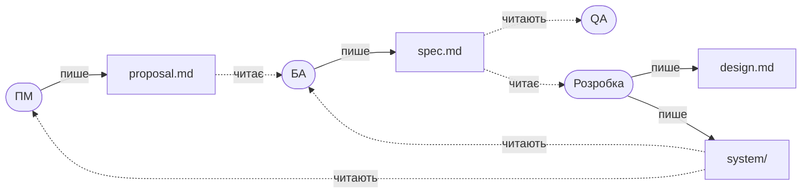

# Що де лежить

```
specs/
├── README.md                     ← почати тут
├── CLAUDE.md                     ← правила для Claude і налаштування команди
├── docs/                         ← як працювати: налаштування, MR, навчальний прохід
├── SDD/
│   ├── constitution.md           ← правила (прочитати один раз)
│   ├── templates/                ← шаблони proposal / spec / design / опису задачі; заповнює Claude
│   │   └── product/              ← шаблон картки продукту
│   ├── checklists/edge-cases.md  ← пограничні випадки; /sdd-ba проходить їх з вами
│   ├── checklists/next-step.md   ← хто наступний: одне правило для всіх скілів
│   └── shop/                     ← один продукт = одна папка (назва — ваша)
│       ├── README.md             ← картка: трекер, код, мітки, таблиця фіч
│       ├── system/               ← як система працює ЗАРАЗ (пише лише розробка)
│       └── changes/
│           └── 42-order-export/  ← ★ ФІЧА: тут ви працюєте
│               ├── proposal.md   ← ПМ: навіщо і що
│               ├── spec.md       ← БА: правила і критерії
│               └── design.md     ← розробка: факти з коду і як
├── .claude/skills/               ← скіли /sdd-pm, /sdd-code-check, /sdd-ba, /sdd-design, /sdd-status
├── .gitlab/                      ← шаблон опису MR (GitLab)
└── .github/                      ← шаблон опису PR (GitHub)
```

## Хто що читає і пише



Правило одне: **кожен пише лише свій файл**. Побачили помилку в чужому — коментар у MR.
