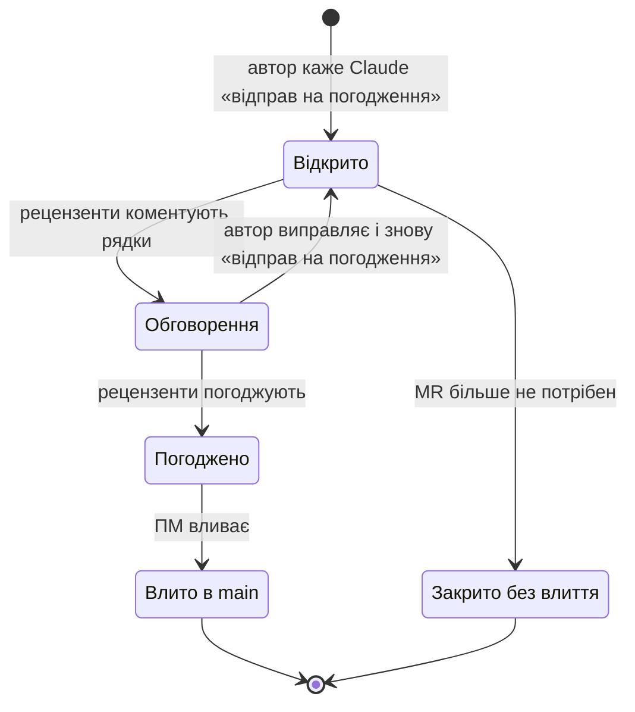

# Як працювати з MR (merge request / pull request)

MR — це сторінка в GitLab (у GitHub вона називається **pull request, PR**), де видно,
**що змінилось** у файлах, і де ці зміни **обговорюють і погоджують**. Ніхто не змінює основну
версію (`main`) напряму: усе — через MR.

## Життя MR



**Чернетка (Draft).** Автор відклав роботу фразою «збережи й відклади»: рецензувати ще не
треба, але видно, що фіча в роботі. У GitLab назва починається з `Draft:`, у GitHub PR
позначений **Draft**. Фраза «відправ на погодження» знімає позначку.

**Скільки MR на фічу.** Один на гейт: перший — proposal, факти й spec (його влиття — **Гейт 1**);
другий, у повному режимі, — design (влиття — **Гейт 2**). Proposal окремо не вливають: його
погоджують у першому MR, а MR лишається відкритим, поки не буде готова spec.

## Де що на сторінці MR

Відкрийте список MR репозиторію специфікацій (GitLab — **Merge requests**, GitHub — **Pull
requests**) → потрібний MR.

| Вкладка GitLab | Вкладка GitHub | Для чого |
|---|---|---|
| **Overview** | **Conversation** | опис, загальні коментарі, кнопки погодження і влиття |
| **Changes** | **Files changed** | що змінено у файлах: зелене — додано, червоне — видалено |
| **Commits** | **Commits** | хто і коли вносив зміни |

## Що ви можете зробити

| Дія | GitLab | GitHub | Коли |
|---|---|---|---|
| **Прокоментувати рядок** | **Changes** → наведіть на рядок → 💬 зліва → текст → **Add comment now** | **Files changed** → наведіть на рядок → **+** зліва → текст → **Add single comment** | питання чи зауваження до конкретного місця. Найкорисніша дія |
| **Запропонувати свій текст** | у коментарі до рядка — **Insert suggestion** (аркуш з ±) | у коментарі до рядка — **Add a suggestion** (аркуш з ±) | знаєте, як написати краще. Автор прийме одним натисканням |
| **Загальний коментар** | **Overview** → поле внизу | **Conversation** → поле внизу | зауваження до всього MR |
| **Погодити** | **Overview** → **Approve** | **Files changed** → **Review changes** → **Approve** → **Submit review** | прочитали, зауважень немає |
| **Закрити обговорення** | під коментарем → **Resolve thread** | під коментарем → **Resolve conversation** | питання вирішено або виправлено |
| **Влити** (лише ПМ) | **Overview** → **Merge** | **Conversation** → **Merge pull request** | усі обговорення закриті, потрібні люди погодили. Для MR зі `spec.md` це **Гейт 1** |
| **Відхилити** | **Close merge request** | **Close pull request** | зміни не потрібні. MR можна відкрити знову (**Reopen**) |

**Кнопки пропозиції не видно?** Вона є лише в коментарі до рядка у вкладці змін, не в
загальному коментарі. Пропозицію можна вписати вручну — у коментар до рядка:

````markdown
```suggestion
Новий текст цього рядка
```
````

Платформа покаже її як пропозицію з кнопкою прийняття.

**Не погоджуєтеся з частиною змін?** Не закривайте MR — прокоментуйте рядок. Закриття означає
«ця зміна не потрібна зовсім».

## Як автору відповісти на коментарі

Не треба правити файли вручну. Скажіть Claude:

> Прочитай коментарі в MR 12 і виправ те, з чим я погоджуюсь

Claude покаже коментарі, ви вирішите, що приймати, — він виправить файли і на «відправ на
погодження» оновить той самий MR. Обговорення, на які відповіли, закрийте.

## Хто що робить у MR

| Роль | Дії |
|---|---|
| Автор (ПМ, БА, розробка) | відкриває MR, відповідає на коментарі, виправляє |
| Рецензенти (ПМ, БА, QA, розробка, замовник) | коментують рядки, пропонують текст, погоджують |
| ПМ (має право вливати) | вливає — закриває гейт; закриває — відхиляє |

Порядок погоджень для кожного файлу — у [SDD/constitution.md](../SDD/constitution.md), розділ 2.
