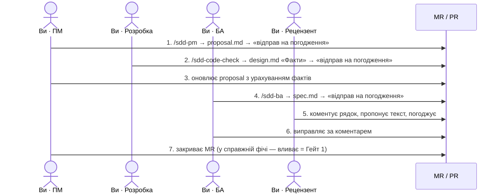

# Пройти весь пайплайн самому

Навчальна фіча, у якій **ви по черзі — ПМ, розробник, БА і рецензент**. ~45 хвилин.
Наприкінці MR закривається без влиття: в основну версію нічого не потрапляє.

Ролі перемикаються просто: **інший скіл = інша роль**. Нову сесію Claude відкривати не треба.

## Навчальна задача

Скопіюйте цей текст — він замінює задачу в трекері:

> **Навчання: кнопка «Копіювати номер замовлення».** Клієнти й менеджери часто копіюють
> номер замовлення (наприклад, `ORD-2026-000123`), щоб надіслати його колегам чи вставити в
> платіжку. Виділяти його мишею незручно, часто захоплюються зайві символи. Потрібна кнопка
> поруч із номером на сторінці замовлення, яка копіює номер одним натисканням і показує
> підтвердження.

Якщо ваш продукт — не магазин, придумайте схожу дрібницю зі свого продукту: кнопка, яка
копіює номер, посилання чи код.

## Крок 0 · Підготовка

Скажіть Claude:

> Перейди на main і онови з сервера. Це навчальний прохід SDD: фіча `0000-training-<ваше-прізвище-латиницею>`, продукт <ваш продукт>, задачі в трекері немає — текст задачі дам сам. Веди журнал розмови.

Картки продукту ще немає — Claude запропонує створити її з шаблону. Журнал (`sdd-log.md`)
знадобиться, щоб потім розібрати, де ви спіткнулися.

## Крок 1 · Ви — ПМ

> /sdd-pm

Вставте текст навчальної задачі. Claude запропонує режим (оберіть **Швидкий**), заповнить
чернетку і поставить до 5 питань — по одному, з рекомендованою відповіддю.

✅ **Перевірте в `proposal.md`:** проблема — одна історія; є метрика з порогом; заповнено
«Не входить»; є «Питання до розробки» (наприклад, «де на сторінці показано номер замовлення»).

> Відправ на погодження

Claude дасть посилання на MR — відкрийте його ([як читати MR](merge-requests.md)).

## Крок 2 · Ви — розробка

> /sdd-code-check

- **Є доступ до коду** (репозиторій з картки продукту): Claude спитає шлях до клону, прочитає
  гілку продукту і відповість на питання фактами з посиланнями на рядки коду.
- **Немає доступу** (ПМ, БА): скажіть «доступу до коду немає, відповім сам» — і дайте відповіді
  як здогадки. Claude ставитиме відкриті питання без готових варіантів: факти не вибирають зі
  списку. У справжній фічі так не можна, але для навчання достатньо.

✅ **Перевірте:** з'явився `design.md` з таблицею «Факти»; у `proposal.md` заповнено колонку
«Відповідь розробки». Подивіться на позначки надійності ✅ / ⚠️ / ❓.

> Відправ на погодження

## Крок 3 · Ви — знову ПМ

Подивіться на колонку «Наслідок для proposal / spec» у `design.md`. Якщо факт щось змінює
(наприклад, номер замовлення показується у двох місцях), скажіть:

> Онови proposal з урахуванням фактів з design.md

## Крок 4 · Ви — БА

> /sdd-ba

Claude пройде пограничні випадки (що на телефоні? якщо браузер не дає копіювати? хто бачить
кнопку?) і запише правила за шаблоном КОЛИ / ЯКЩО … ТО, тексти і критерії Дано / Коли / Тоді.
Спробуйте на одне питання навмисно відповісти технічно («зробити через Clipboard API») — Claude
має сказати, що це рішення розробки, і не писати це в spec.

✅ **Перевірте в `spec.md`:** кожне правило — одне речення з КОЛИ / ЯКЩО; у кожного є КП;
є хоча б один негативний КП.

> Відправ на погодження

## Крок 5 · Ви — рецензент (у браузері)

У MR, вкладка змін (GitLab — **Changes**, GitHub — **Files changed**):

1. Прокоментуйте будь-яке правило в `spec.md` — значок біля рядка.
2. В іншому рядку **запропонуйте свій текст** — кнопка пропозиції в панелі коментаря
   до рядка ([якщо її не видно](merge-requests.md#що-ви-можете-зробити)).
3. Погодьте MR. *(Якщо платформа не дає погодити власний MR — це налаштування проєкту, пропустіть.)*

## Крок 6 · Ви — знову БА

> Прочитай коментарі в моєму MR і виправ spec.md

Погодьтеся з одним коментарем, з іншим — ні. Потім «відправ на погодження» і в браузері
закрийте обговорення (**Resolve**).

## Крок 7 · Ви — ПМ, фінал

У справжній фічі тут ПМ вливає MR — це **Гейт 1**, спеку можна брати в розробку.
Для навчання **закрийте MR без влиття** і скажіть Claude:

> Видали мою навчальну гілку

## Що ви щойно відпрацювали

| Навичка | Де знадобиться |
|---|---|
| Інтерв'ю зі скілом замість написання тексту з нуля | щоразу |
| Межа «що / як»: технічне — у design, не в spec | кожна рецензія |
| Факти з коду **до** правил | менше переробок і хибних припущень |
| Коментар до рядка й запропонований текст | замість переписок у месенджері |
